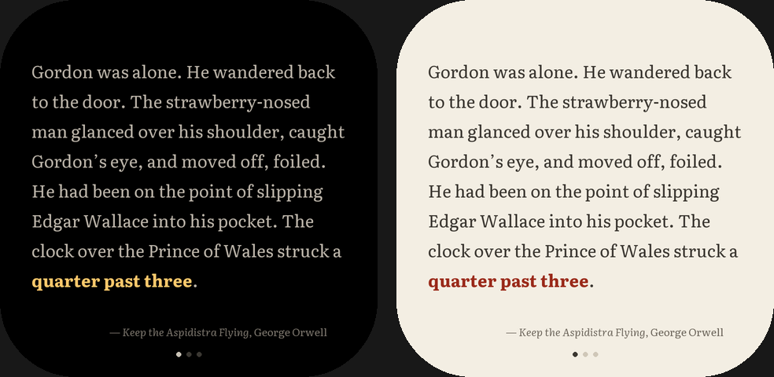

# Literature Clock for ESP-Mosaico



A clock that tells the time with a line from a book. For every minute of the day it shows
a quote that mentions that time, with the time phrase **highlighted**, and the book and
author underneath.

It's an app (an *Idea*) for the [ESP-Mosaico](https://github.com/esp-mosaico/esp-mosaico-vibe)
and installs **next to Vibe Mode**: Vibe Mode, your other Ideas and your settings stay in place.
It was inspired by the Kindle
[Literary Clock](https://www.instructables.com/Literary-Clock-Made-From-E-reader/) projects and
rebuilt for the Mosaico's round-cornered 480×480 screen.

## Features

* **1,996 quotes** covering 1,347 of the day's 1,440 minutes. A minute without its own quote keeps
  the latest earlier one, and the exact time is then shown in small digits at the top.
* The quote is typeset in [Literata](https://github.com/googlefonts/literata), Google's e-book
  typeface, at the largest size that fits the screen (16–46 px). The time phrase is bold and coloured.
* **Tap** the screen for another quote for the same minute. The dots at the bottom show how many there are.
* **Long-press** to switch between the **dark** theme (light text on black) and the **paper** theme
  (ink on cream, like an e-reader). The choice is remembered.
* Dims at night (23:00–07:00 by default).
* Sets the time over the **Wi-Fi saved in Vibe Mode** and finds the **timezone** automatically.

## Quotes and copyright

**The quotes are not covered by this project's license. All copyright in each quote belongs
to its author, translator or publisher.**

* Each quote is a short excerpt shown with its book title and author, as an
  attribution. Many come from works still under copyright.
* The collection grew out of a 2011 call by *The Guardian* for readers to find mentions of times of day
  in books. It has since been used by many literary-clock projects.
* The quotes for 443 minutes that the original list didn't cover (`data/litclock_extra.csv`) come from
  Johannes Enevoldsen's [literature clock](https://github.com/JohannesNE/literature-clock) list.
  Only quotes it marks as safe for work are used. That list, and this selection from it, are under
  [CC BY-NC-SA 2.5](https://creativecommons.org/licenses/by-nc-sa/2.5/), so they can't be used
  commercially (see [`data/LICENSE-litclock_extra.md`](data/LICENSE-litclock_extra.md)).
* The quotes are reproduced here only to tell the time, in a free, non-commercial project. No
  claim of ownership is made over them.
* **Rights holders:** if you'd like a quote removed or its attribution corrected, please
  [open an issue](https://github.com/mkulukkallur/esp-mosaico-literature-clock/issues) and it will be removed or corrected.

The project's own code, tools and artwork are MIT-licensed (see [License](#license)).

## Install

### From the Mosaico Idea center

Find **Literature Clock** in the Idea center and install it on your Mosaico. Make sure Wi-Fi is set
up in Vibe Mode first: the clock needs it to set the time.

### From source

Requirements:

* Windows, macOS or Linux, with Python 3.10+ and Git 2.28+
* ESP-IDF at the commit the Mosaico workspace pins
* The [esp-mosaico-vibe](https://github.com/esp-mosaico/esp-mosaico-vibe) workspace
* An ESP-Mosaico connected by USB-C, with Wi-Fi set up in Vibe Mode

```bat
:: 1. Get the Mosaico workspace (once)
cd C:\esp
git clone https://github.com/esp-mosaico/esp-mosaico-vibe.git
cd esp-mosaico-vibe
git submodule update --init submodule/esp-mosaico-utils submodule/esp-mosaico-bsp

:: 2. Put this repository in the workspace's projects folder
git clone https://github.com/mkulukkallur/esp-mosaico-literature-clock.git projects\literature_clock

:: 3. Load ESP-IDF, then build and install through Vibe Mode
C:\esp\espv6.2esp-idf\export.bat
python mosaico.py iris system-update --project projects/literature_clock
```

The first build takes several minutes. The project must sit at
`<workspace>/projects/literature_clock`, because its build files find the Mosaico SDK at `../../submodule`.

If `system-update` reports that the board's base system is missing or incompatible, run
`python mosaico.py recover` once, then run `system-update` again.

### Everyday use

| Task | How |
|---|---|
| Another quote for this minute | Tap the screen |
| Dark / paper theme | Long-press the screen |
| Get back to Vibe Mode | Hold the **AI** button while powering on |
| See logs | `python mosaico.py iris logs --project projects/literature_clock` |
| Reinstall after changes | `python mosaico.py iris system-update --project projects/literature_clock` |

## Timezone

The time comes from the internet (NTP). The timezone is chosen in this order:

1. **Set on the device:** in Vibe Mode, open Settings > **Shared information** and add the key
   `clock_timezone`. The value is either
   - a zone name, such as `America/Chicago`, `Europe/London` or `Asia/Kolkata` (capital letters don't matter), or
   - a POSIX rule, such as `CST6CDT,M3.2.0,M11.1.0`.

   This works for Idea-center installs. Delete the entry to go back to automatic.
2. **Automatic:** one request per start-up to [ipinfo.io](https://ipinfo.io), which returns the
   timezone of your internet address. A VPN can make this wrong.
3. **Fallback:** `LC_TIMEZONE` in menuconfig (US Eastern by default).

The screen shows "Setting the clock…" until the time is known.

## Settings (menuconfig, source builds only)

```bat
C:\esp\espv6.2esp-idf\export.bat
cd C:\esp\esp-mosaico-vibe
idf.py -C projects/literature_clock menuconfig
```

Open **Literature Clock** (near the bottom), make your changes, then press **S** to save and **Q** to quit.
Reinstall with `system-update`.

| Setting (symbol) | Default | What it does |
|---|---|---|
| Fallback Wi-Fi name / password (`LC_WIFI_SSID`, `LC_WIFI_PASSWORD`) | *(empty)* | Leave empty to use the Wi-Fi saved in Vibe Mode |
| Automatic timezone (`LC_TZ_AUTO`) | on | Look up the timezone from the internet address |
| IP timezone URL (`LC_IP_TZ_URL`) | `https://ipinfo.io/json` | Must return JSON with a `timezone` field |
| Fallback timezone (`LC_TIMEZONE`) | `EST5EDT,M3.2.0,M11.1.0` | POSIX rule used when nothing else gives one |
| Starting theme (`LC_THEME_*`) | Dark | Dark or Paper. A long-press switches at any time |
| Show the time in digits (`LC_SHOW_TIME_*`) | Only when no exact quote | Or Always / Never |
| Random quote (`LC_RANDOM_QUOTE`) | on | Pick a random quote when a minute has several |
| Dim at night (`LC_NIGHT_DIM`) | on | Start/end hour (23 / 7), day/night brightness (100 % / 25 %) |

## Changing the quotes

The quotes are in [`data/litclock.csv`](https://github.com/mkulukkallur/esp-mosaico-literature-clock/blob/main/data/litclock.csv)
and [`data/litclock_extra.csv`](https://github.com/mkulukkallur/esp-mosaico-literature-clock/blob/main/data/litclock_extra.csv),
one per line, `|`-separated, UTF-8:

```
HH:MM|time phrase exactly as it appears in the quote|quote|title|author
```

After editing, regenerate the quote table and the font subsets (the fonts contain only the
characters the quotes use), then reinstall:

```bat
python -m pip install "fonttools>=4.50" Pillow
python tools/build_quotes.py
python tools/build_fonts.py
python tools/preview.py
```

* `import_extra.py path/to/litclock_annotated.csv` rebuilds `litclock_extra.csv` from a newer copy of
  the JohannesNE list (safe-for-work quotes for minutes `litclock.csv` doesn't cover).
* `build_quotes.py` warns about any quote whose time phrase it can't find. That quote is shown
  without a highlight.
* `preview.py` checks that every quote fits the screen and redraws `preview.png`.
* `tools/build_tz.py` regenerates the timezone table from Python's `tzdata`.
* `tools/gen_presentations.py` regenerates the Idea-grid labels and icon.

## How it works

| File | Purpose |
|---|---|
| `main/main.c` | Start-up: ESP-Iris and Vibe Mode support, display, Wi-Fi, time |
| `main/clock_ui.c` | The screen: fitting and drawing the quote, tap / long-press, themes, night dimming |
| `main/quotes.c` | Picks the quotes for a minute, falling back to the latest earlier minute |
| `main/quotes_data.c` | *Generated* quote table: text, title, author and the highlight's byte range |
| `main/clock_time.c` | Timezone (shared setting → IP lookup → menuconfig) and NTP |
| `main/tz_table.c` | *Generated* table mapping IANA zone names to POSIX rules (520 zones) |
| `main/fonts/*.ttf` | *Generated* Literata Regular / Bold / Italic subsets, rendered by LVGL Tiny TTF |
| `main/wifi.c` | Reads the Wi-Fi saved in Vibe Mode; station mode |

The quote is an LVGL span group of three spans: the text before the time phrase, the
phrase itself and the text after it. For each new quote the clock tries font sizes from 46 px
down, keeps the first that fits above the attribution, then centres the quote vertically.

## Packaging for the Mosaico Idea center

```bat
C:\esp\espv6.2esp-idf\export.bat
cd C:\esp\esp-mosaico-vibe
python mosaico.py iris system-update --project projects/literature_clock
python -m pip install "jsonschema>=4.23,<5" "markdown-it-py>=3,<5"
python mosaico.py project package --project projects/literature_clock --output dist\literature_clock-1.0.1.zip
python mosaico.py project validate dist\literature_clock-1.0.1.zip --json
python mosaico.py account login
python mosaico.py project upload dist\literature_clock-1.0.1.zip --create
```

(`--create` is for a first upload only; a new version of an existing app uses `--update PUBLIC_ID`.)

`mosaico-ideas.json` uses the current Idea-center format (`content_type`, `category_id` 30 =
Tools software). Workspaces whose toolkit predates Espressif's November 2026 update can't upload:
their upload address no longer exists (HTTP 404). Update the workspace, or run `project package` and
`project upload` with the current [esp-mosaico-utils](https://github.com/esp-mosaico/esp-mosaico-utils).

`system-update` builds `build/literature_clock-system-update.irisfw`, which the package
includes, and installs it as a final test. `upload` creates a **draft**; you publish it on the website.

For a new version:

1. Bump `project(literature_clock VERSION x.y.z)` in `CMakeLists.txt`.
2. Add a `CHANGELOG.md` entry.
3. Rebuild and re-package.
4. Upload with `--update PUBLIC_ID`, using the ID the first upload printed (`--create` would make a second app).

## License

The code, tools and artwork in this repository are released under the [MIT License](LICENSE),
**except for the following**, which keep their own terms:

* **Quotes** (`data/litclock.csv`, `data/litclock_extra.csv`, `main/quotes_data.c`): copyright belongs
  to the respective authors and publishers. See [Quotes and copyright](#quotes-and-copyright).
  The selection in `data/litclock_extra.csv` comes from Johannes Enevoldsen's list and is under
  CC BY-NC-SA 2.5.
* **Font:** Literata, © The Literata Project Authors, under the SIL Open Font License 1.1
  ([`fonts/OFL.txt`](fonts/OFL.txt)). `main/fonts/` holds subsets of it.
* **Idea-grid labels** (`store/device/`): rendered from Noto Sans SC (SIL Open Font License 1.1).
* **Timezone data:** IANA Time Zone Database (public domain).
* **Template files** (`partitions.csv`, `sdkconfig.defaults`, `tools/quality/` and the
  editor/pre-commit configs): these come from Espressif's ESP-Mosaico application template.
  Espressif hasn't published a license for them yet, and this project doesn't relicense them.

Online services used at run time: time from [pool.ntp.org](https://www.ntppool.org),
timezone lookup by [ipinfo.io](https://ipinfo.io).
